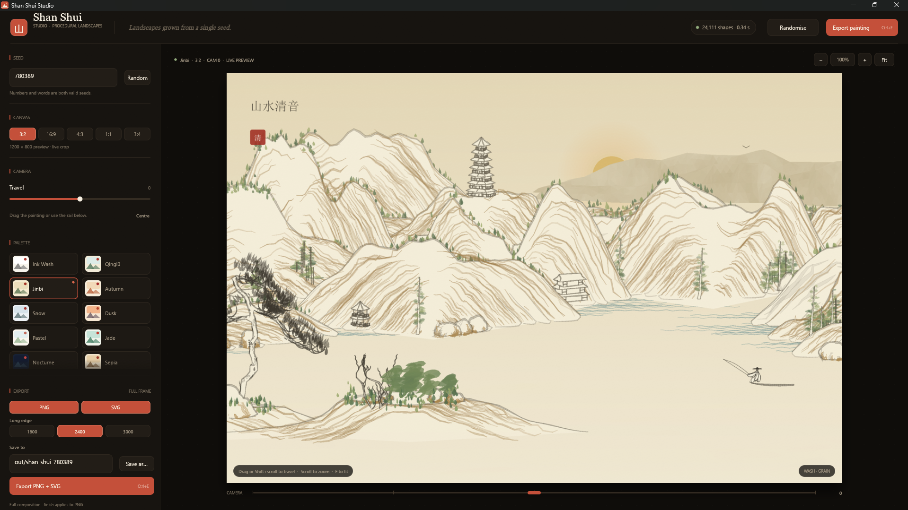
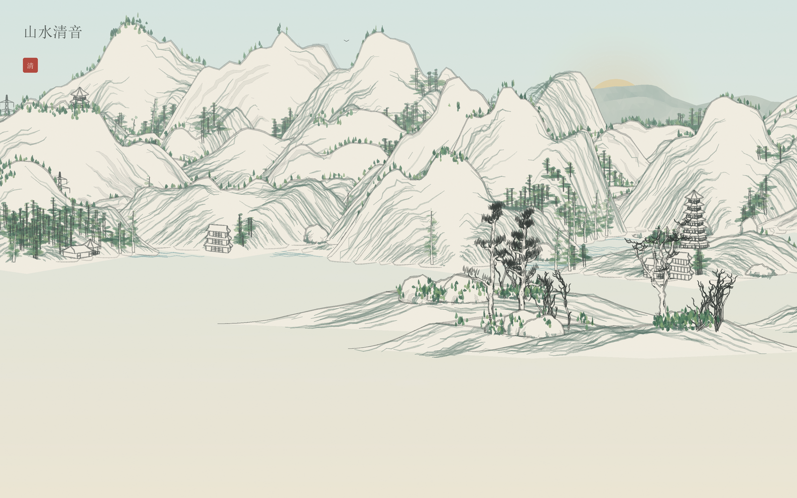
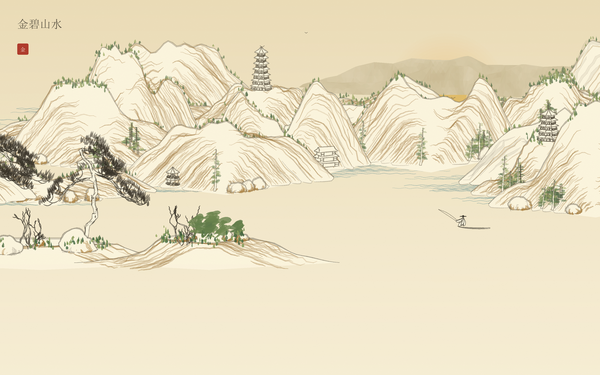
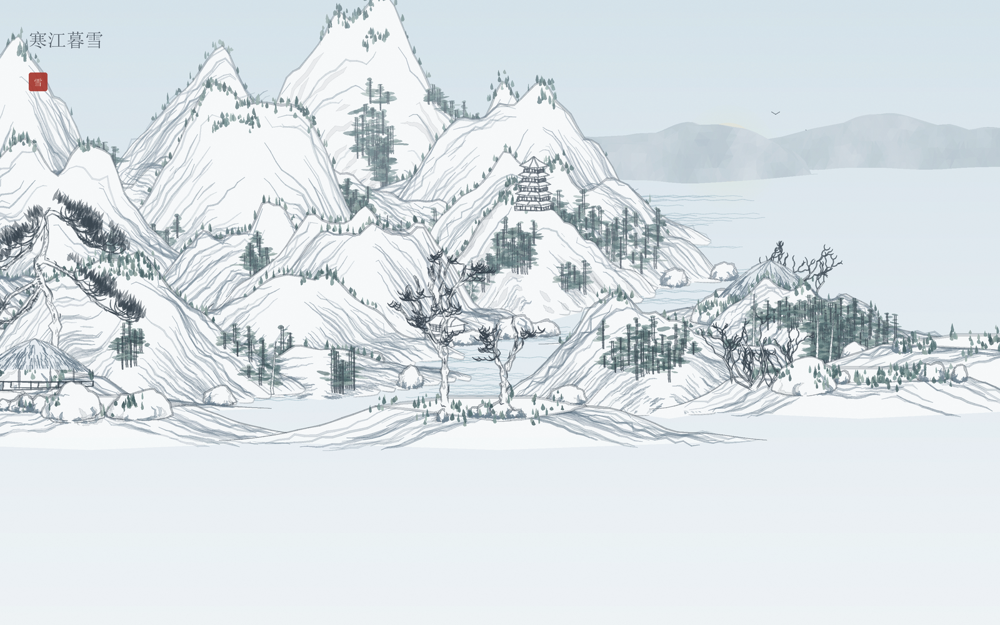
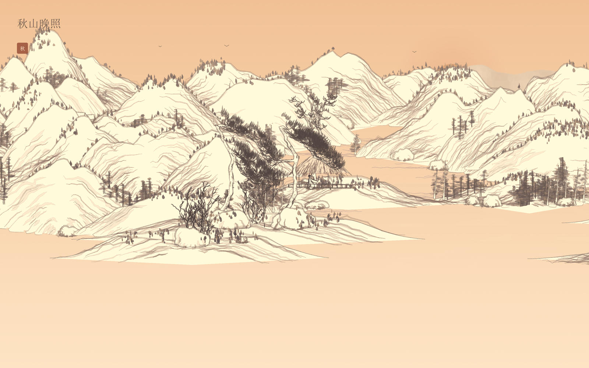
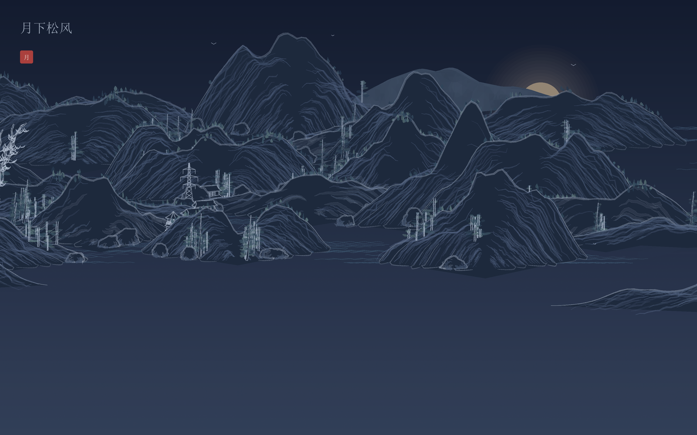

<div align="center">



# {Shan, Shui}\* — Rust Edition

### Shan Shui Studio

**Procedural Chinese landscape paintings, grown from a single seed.**

A native Rust port of [LingDong-'s {Shan, Shui}\*](https://github.com/LingDong-/shan-shui-inf) — the original browser landscape generator — with a realtime desktop studio, a reproducible CLI, and PNG/SVG export.

<sub>Rust 1.95+ · MIT · Windows, macOS and Linux</sub>

</div>

---

## A landscape, not a filter

Every painting is built from scratch: mountain ridges, pine and broadleaf trees, pavilions, huts, boats, people, water, mist, birds and seals. There are no bitmap assets and no machine-learning step. The same seed and settings always produce the same painting.

The original project renders an infinite SVG scroll in the browser. This edition keeps that mathematical landscape, then puts it inside a focused desktop studio: move the camera along the scroll, change palette and finish, and export a finished painting at print resolution.

## Highlights

- **Deterministic seeds** — integers or words. `qinglv`, `42`, `moon-gate` and `780389` are all valid seeds.
- **12 colour themes** — from literati ink wash to blue-green mineral pigments, gold, snow, dusk and nocturne.
- **5 finishing presets** — Wash, Crisp, Vivid, Vintage and Noir.
- **Realtime Studio** — draft previews while you drag, a sharp render when you stop, and a cached panorama that makes camera travel instant.
- **True vector output** — every tree, roof tile and wave is exported as [SVG](https://developer.mozilla.org/en-US/docs/Web/SVG) geometry, not a traced bitmap.
- **High-resolution [PNG](https://www.w3.org/TR/png/)** — supersampled CPU rasterisation with a [Lanczos-3](https://en.wikipedia.org/wiki/Lanczos_resampling) downsample, paper grain and finish grading.
- **Native Save As** — the [Windows common dialog](https://learn.microsoft.com/en-us/windows/win32/api/commdlg/nf-commdlg-getsavefilenamew) with `PNG + SVG`, `PNG`, and `SVG` filters; filenames follow the seed until you choose your own.
- **Small native binaries** — no browser, scripting runtime or GUI toolkit installation.
- **CLI and library** — the generator is a reusable Rust crate, independent of the GUI.

Built with [Rust](https://www.rust-lang.org/), [eframe/egui](https://github.com/emilk/egui), [ab_glyph](https://docs.rs/ab_glyph) and the [png](https://docs.rs/png) crate.

## Gallery

| | |
|:--:|:--:|
| [](Screenshots/art-qinglv.png)<br><sub>**Qinglü · Wash** · seed `42` · 山水清音</sub> | [](Screenshots/art-jinbi.png)<br><sub>**Jinbi · Crisp** · seed `780389` · 金碧山水</sub> |
| [](Screenshots/art-snow.png)<br><sub>**Snow · Crisp** · seed `20261026` · 寒江暮雪</sub> | [](Screenshots/art-dusk.png)<br><sub>**Dusk · Vintage** · seed `777` · 秋山晚照</sub> |
| [](Screenshots/art-nocturne.png)<br><sub>**Nocturne · Wash** · seed `888` · 月下松风</sub> | <sub>Every painting above was generated by the release Rust CLI. One example command:</sub> |

```bash
shan-shui --theme snow --seed 20261026 --width 1600 --height 1000 \
  --finish crisp --title "寒江暮雪" --seal "雪" --format png \
  --out Screenshots/art-snow
```

## Quick start

### Build

```bash
git clone https://github.com/incredibleamir-dot/shan-shui-rust.git
cd shan-shui-rust
cargo build --release
```

The release build produces two binaries:

| Binary | Purpose |
| --- | --- |
| `target/release/shan-shui-gui` | Shan Shui Studio (Windows: `shan-shui-gui.exe`) |
| `target/release/shan-shui` | Command-line renderer |

The GUI is enabled by default. For a terminal-only build:

```bash
cargo build --release --no-default-features --bin shan-shui
```

### Run the Studio

```bash
cargo run --release --bin shan-shui-gui
```

On Windows the release GUI is linked as a windowed application, so no console window appears behind it. Build with `--features gui-console` if you want stderr and panic messages in a terminal.

> **Platforms:** the generator, CLI and both exporters build on Windows, macOS and Linux. The Studio is developed and tested on Windows 11; its native Save As dialog is Windows-only, so on macOS and Linux type the export path directly into the **Save to** field. Raster inscriptions use the system CJK font; if none of the standard faces is installed, install a Noto CJK or Songti font, or use the SVG export.

## Using the Studio

The window is split into a control sidebar and a large painting canvas.

- **Seed** — type a number or a phrase, then press Enter or use **Random**. **Ctrl+R** also randomises the seed.
- **Canvas** — choose 3:2, 16:9, 4:3, 1:1 or 3:4.
- **Camera** — drag the painting, drag the rail at the bottom, or hold **Shift** and scroll. Scroll to zoom from 100% to 400%; double-click or press **F** to fit.
- **Inscription** — optional title and seal text, with a size slider.
- **Palette** — 12 themes with live swatches.
- **Density** — architecture, people, boats and dust from 0% to 100%; toggles for sky, sun, mist, vegetation and paper grain.
- **Finish** — choose a grading preset; it is applied to the PNG export and the live preview.
- **Export** — choose PNG and/or SVG, a long edge of 1600, 2400 or 3000 px, and a base path. **Ctrl+E** exports.

### Saving files

The **Save as…** button opens the [native Windows dialog](https://learn.microsoft.com/en-us/windows/win32/api/commdlg/nf-commdlg-getsavefilenamew) and chooses a *base path*. It does not write the files by itself. The export pipeline writes `<base>.png` and/or `<base>.svg` when you press **Export**. This means you can choose a destination once, adjust the painting, and export again without reopening the dialog.

By default the base path follows the seed: `out/shan-shui-42` for seed `42`. Typing in the **Save to** field, or choosing a path in the dialog, stops the automatic tracking. **Use seed name** restores it.

## Command line

The examples below assume `shan-shui` is on your `PATH` (for example after `cargo install --path .`). From a fresh build, use `target/release/shan-shui`.

```bash
# List the built-in palettes
shan-shui --list-themes

# A classic painting, both formats
shan-shui --theme qinglv --seed 42 --title "山水清音" --seal "清" \
  --width 1600 --height 1000 --out out/shan-shui-42

# A large PNG with a vintage finish
shan-shui --theme dusk --seed 777 --format png --finish vintage \
  --width 3000 --height 2000 --out out/autumn-dusk

# A quiet winter study with no buildings or people
shan-shui --theme snow --seed winter-light --format png \
  --architecture 0 --people 0 --boats 0 --finish crisp \
  --out out/winter-light
```

Run `shan-shui --help` for all options. Important flags:

| Flag | Description |
| --- | --- |
| `--seed <SEED>` | Integer or text seed. Omit for a time-based seed. |
| `--theme <THEME>` | One of the 12 palettes. Default `ink`. |
| `--camera <X>` | Horizontal centre of the view. Default `0`. |
| `--width`, `--height` | Output size in pixels. Default `1200 × 800`. |
| `--format <png\|svg\|both>` | Output format. Default `both`. |
| `--out <PATH>` | File or base path. `.png`/`.svg` are added automatically. |
| `--supersample <N>` | PNG supersampling factor. Default `2`. |
| `--finish <PRESET>` | `wash`, `crisp`, `vivid`, `vintage` or `noir`. |
| `--title`, `--seal` | Inscription and red seal. |
| `--title-size <PX>` | Inscription size. Default `22`. |
| `--paper`, `--no-paper` | Paint the paper background. Default on. |
| `--grain`, `--no-grain` | Paper grain. Default on. |
| `--sky`, `--sun`, `--mist` | Toggle sky gradient, sun and mist. |
| `--vegetation` | Toggle trees and greenery. |
| `--architecture`, `--people`, `--boats`, `--dust` | Densities from `0` to `1`. |
| `--birds <N>` | Number of birds. Default `5`. |
| `--chunk-width <PX>` | Generation chunk width. Default `512`. |

The CLI writes deterministic files. If you re-run the same command, the PNG and SVG are byte-for-byte reproducible on the same platform and font set.

## Themes and finishes

### Themes

| Theme | Character |
| --- | --- |
| `ink` | Monochrome literati ink on warm paper |
| `qinglv` | Blue-green mineral pigments, the classic `青绿` landscape |
| `jinbi` | Gold and ochre court style |
| `autumn` | Russet, amber and dry-brush brown |
| `snow` | Pale blue winter light |
| `dusk` | Warm apricot twilight |
| `pastel` | Soft chalk colours |
| `jade` | Cool green stone |
| `nocturne` | Deep indigo night with a pale moon |
| `sepia` | Aged album-leaf brown |
| `porcelain` | Blue-and-white porcelain |
| `blossom` | Plum-pink spring |

### Finishes

| Finish | Effect |
| --- | --- |
| `wash` | Neutral, soft paper-and-ink look |
| `crisp` | A little more contrast and saturation |
| `vivid` | Stronger colour separation |
| `vintage` | Warm, faded cross-process grade |
| `noir` | Black-and-white with lifted contrast |

Finish grading is applied to the raster PNG. The SVG remains pure vector geometry and keeps the theme's original colours.

## Changes from the original

The original **{Shan, Shui}\*** is a browser piece: [HTML](https://developer.mozilla.org/en-US/docs/Web/HTML), [JavaScript](https://developer.mozilla.org/en-US/docs/Web/JavaScript), [p5.js](https://p5js.org/) noise and an endlessly scrolling SVG. This repository is a direct Rust port of that generator and adds:

- **A native single-binary Studio.** No browser tab, runtime or GUI toolkit to install. On Windows, the release GUI opens without a console window.
- **Instant camera travel.** Instead of re-rendering the whole scene on every camera move, the Studio renders a cached wide strip once and scrolls a UV window through it. Camera-only changes skip the draft pass entirely; the sharp pass catches up when the view settles.
- **A deeper art direction panel.** 12 palettes and 5 finish presets, with grain, paper, sky, sun, mist, vegetation, architecture, people, boats and dust controls.
- **A native save workflow.** The [Windows common Save dialog](https://learn.microsoft.com/en-us/windows/win32/api/commdlg/nf-commdlg-getsavefilenamew) offers combined, PNG-only and SVG-only filters, and export paths follow the seed until you edit them.
- **An asynchronous render pipeline.** Draft and final previews run on a worker with cancellation; exports run on a separate worker with progress stages, so the UI stays responsive.
- **Print-sized exports.** 1600, 2400 or 3000 px on the long edge, PNG and SVG from the same composition, with seed-stable grain.
- **A reusable crate.** The generator, palettes, rasteriser and SVG writer are exposed as a Rust library; the CLI and GUI are thin front ends.
- **A reproducible CLI.** RNG child streams, item ordering and SVG serialisation follow the original project's design, and `examples/dump_scene.rs` emits a stable scene dump for regression checks.

## How it works

The short version:

1. A seed is hashed into a [Blum-Blum-Shub](https://en.wikipedia.org/wiki/Blum_Blum_Shub) generator. Every component gets a labelled child stream, so adding a tree does not reshuffle the mountains.
2. A [p5.js](https://p5js.org/)-compatible [Perlin noise](https://en.wikipedia.org/wiki/Perlin_noise) field decides where mountain massifs, distant ranges, flats and boats belong along an endless horizontal strip.
3. Items are generated in 512 px chunks and cached. Each item expands into low-level polygons, circles, gradients and text.
4. The renderer sorts by depth and y, paints the sky, sun, birds, mountains, water, mist, buildings, trees and inscription, then supersamples and downsamples the PNG or serialises the same shapes to SVG.
5. The Studio keeps a 0.9-scale panorama of the whole travel range and crops it with a UV window; exports re-render the full composition sharply at the chosen size.

The full pipeline, including the RNG, noise, chunking, geometry and panorama maths, is documented in **[algo.md](algo.md)**.

## Using the crate

```rust
use shan_shui::render::{render_shapes, save_png, RenderOptions};
use shan_shui::rng::Seed;
use shan_shui::scene::{Scene, SceneOptions};

fn main() -> Result<(), String> {
    let mut scene = Scene::new(SceneOptions {
        seed: Some(Seed::Int(42)),
        theme: "qinglv".into(),
        title: "山水清音".into(),
        seal: "清".into(),
        ..Default::default()
    })?;

    let shapes = scene.render(None, None, None, None);
    let bitmap = render_shapes(&shapes, &RenderOptions::default());
    save_png(std::path::Path::new("out/seed-42.png"), &bitmap)
}
```

The `examples/` directory contains runnable programs for scene dumps, camera benchmarks, primitive probes and tree regression checks:

```bash
cargo run --release --example dump_scene -- --seed 42 --width 480 --height 320
cargo run --release --example bench_camera
```

## Project layout

```
.
├── src/
│   ├── main.rs           CLI entry point
│   ├── gui_main.rs       Shan Shui Studio
│   ├── lib.rs            public crate surface
│   ├── scene.rs          world, chunks and composition
│   ├── planner.rs        noise-driven item placement
│   ├── mountains.rs      massifs, flats, distant ranges, rocks
│   ├── trees.rs          pines, broadleaf trees, bark and branches
│   ├── architecture.rs   huts, pavilions, pagodas, boats, towers
│   ├── water.rs          rivers, lakes, seas, mist and birds
│   ├── people.rs         figures and hats
│   ├── color.rs          12 palettes and depth haze
│   ├── finish.rs         post-processing presets
│   ├── context.rs        shared RNG, noise, palette and density state
│   ├── primitives.rs     geometry and random helpers for generators
│   ├── shapes.rs         shape primitives emitted by the world
│   ├── rng.rs            seed hash and Blum-Blum-Shub streams
│   ├── noise.rs          p5.js-compatible Perlin noise
│   ├── geometry.rs       curves, triangulation and polygon helpers
│   └── render/
│       ├── mod.rs        render entry points and options
│       ├── raster.rs     supersampled CPU rasteriser, grain, finishes
│       ├── svg.rs        vector serialiser
│       └── text.rs       CJK fonts, inscriptions and seals
├── examples/             scene dumps, benchmarks and regression probes
├── Screenshots/          Studio and generated-art images
├── algo.md               algorithm and rendering notes
├── README.md
├── LICENSE
├── Cargo.toml
└── Cargo.lock
```

## Determinism and reproducibility

The generator never reads a clock, a random device or a global mutable state during composition. All randomness comes from labelled child streams of the seed. That is why the same seed and options reproduce the same painting across runs, and why changing the title or the camera does not change the landscape.

This repository is a direct Rust implementation of the original browser generator. Its RNG, noise construction, child-stream labels, item ordering and shape ordering follow the original project's design; the renderers reproduce the composition rather than resampling it. The SVG writer is intentionally strict about numeric formatting (two decimals with trailing zeros removed), so generated files diff cleanly between runs.

Gallery images in this README were produced by the release Rust CLI, not by a separate illustration pipeline.

## References

- [{Shan, Shui}\* — original browser generator](https://github.com/LingDong-/shan-shui-inf)
- [p5.js `noise()` reference](https://p5js.org/reference/p5/noise/)
- [Perlin noise](https://en.wikipedia.org/wiki/Perlin_noise)
- [Blum-Blum-Shub](https://en.wikipedia.org/wiki/Blum_Blum_Shub)
- [Lanczos resampling](https://en.wikipedia.org/wiki/Lanczos_resampling)
- [HTML](https://developer.mozilla.org/en-US/docs/Web/HTML)
- [JavaScript](https://developer.mozilla.org/en-US/docs/Web/JavaScript)
- [SVG](https://developer.mozilla.org/en-US/docs/Web/SVG)
- [PNG specification](https://www.w3.org/TR/png/)
- [eframe / egui](https://github.com/emilk/egui)
- [ab_glyph](https://docs.rs/ab_glyph)
- [png crate](https://docs.rs/png)
- [Windows `GetSaveFileNameW`](https://learn.microsoft.com/en-us/windows/win32/api/commdlg/nf-commdlg-getsavefilenamew)
- [MIT License](https://opensource.org/license/mit)

## Credits

- **{Shan, Shui}\*** — original concept, generator, and browser implementation by [LingDong-](https://github.com/LingDong-). [Original repository](https://github.com/LingDong-/shan-shui-inf).
- **This repository** — direct Rust port, native Studio, cached panorama, CLI, tests, documentation and artwork. [shan-shui-rust](https://github.com/incredibleamir-dot/shan-shui-rust).

The algorithm and visual language belong to the original project. This edition is an independent Rust port and is not affiliated with the original author.

## License

MIT. See [LICENSE](LICENSE).

The original {Shan, Shui}\* is also MIT licensed. All upstream copyright notices are retained in the license file.
